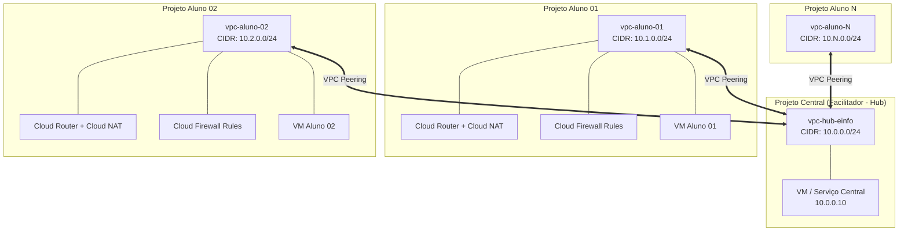

<div align="center">
  

  # Redes.tf: da Teoria à Prática com Terraform e GCP

  **Minicurso Oficial — e-info | FACAPE**

  
  
  
  -2EA44F?style=for-the-badge)
</div>

---

## Sobre o Minicurso

Um mergulho prático de **8 horas** nos fundamentos de **Infraestrutura de Redes**, saindo da teoria de sala de aula direto para a nuvem. Utilizando o **Google Cloud Platform (GCP)** e as boas práticas do **Terraform**, o curso conecta conceitos clássicos de redes de computadores (**sub-redes, CIDR, roteamento, firewalls, NAT e VPC Peering**) com sua aplicação real em ambientes cloud modernos.

Durante o curso, **construiremos toda a infraestrutura do zero ao fim (*Live Coding*)**, começando com recursos nativos para entender profundamente como cada componente funciona e evoluindo até a organização profissional em **Módulos do Terraform (`modules/`)**.

---

## Facilitador

**Luan Sousa**  
*Cloud Engineer na **SantoDigital** (Parceira Google Cloud)*

Atua no desenho, na implantação e na sustentação de infraestrutura em nuvem. Sua trajetória inclui projetos de Fullstack, DevOps, Infraestrutura e SecOps, trazendo ao curso uma visão completa de como redes são projetadas, automatizadas e protegidas em ambientes reais. É certificado **Google Cloud Digital Leader** e bacharelando em **Ciência da Computação pela FACAPE**.

---

## Arquitetura do Laboratório (Dinâmica *Hub-and-Spoke*)

Cada participante trabalha em seu **próprio projeto GCP individual** (configurado no [Pré-material](./pre-material/README.md)) e constrói sua VPC do zero. Na etapa de interconexão, todas as redes dos alunos são integradas a um **Projeto Central (Hub)** mantido pelo facilitador via **VPC Network Peering**.



> [!IMPORTANT]
> **Convenção de Endereçamento por Aluno (`student_id`):**  
> Para evitar conflito de faixas de IP (*CIDR overlap*) no momento do VPC Peering com o Projeto Central (`10.0.0.0/24`), cada participante receberá um **ID numérico (`01` a `99`)** e utilizará o bloco **`10.<ID>.0.0/24`** em sua sub-rede.

---

## Estrutura do Repositório

O repositório está organizado em pastas de contexto para facilitar tanto o acompanhamento ao vivo quanto a consulta posterior:

```text
mini-curso-redes-tf-gcp/
├── docs/                            # Ficha executiva do minicurso, logo da FACAPE e ementa detalhada
│   ├── Ficha do Mini Curso.md       # Ficha oficial do curso no evento e-info
│   ├── logo-facape.svg              # Identidade visual da FACAPE
│   └── ementa/                      # Cronograma detalhado das 8h (Manhã e Tarde) e roteiro
├── pre-material/                    # OBRIGATÓRIO ANTES DO CURSO: Setup de ferramentas e foundation GCP
│   └── foundation-check/            # Script/Terraform inicial para testar seu ambiente antes da aula
├── terraform/                       # Infraestrutura como Código (Terraform + GCP)
│   ├── live-coding/                 # Diretório limpo onde construímos tudo do zero ao fim na aula
│   ├── labs/                        # Guia passo a passo e gabarito (checkpoints) de cada etapa:
│   │   ├── 01-vpc-subnets/          # Etapa 01: VPC Customizada e Sub-redes
│   │   ├── 02-firewall-vms/         # Etapa 02: Regras de Firewall, Tags e VMs de teste
│   │   ├── 03-roteamento-nat/       # Etapa 03: Roteamento, Cloud Router e Cloud NAT
│   │   ├── 04-vpc-peering-hub/      # Etapa 04: VPC Peering com o Projeto Central (Hub)
│   │   └── 05-boas-praticas-modules/# Etapa 05: Refatorando para Módulos do Terraform
│   ├── modules/                     # Módulos reutilizáveis de referência (Boas Práticas)
│   └── hub-facilitador/             # Infraestrutura do Projeto Central mantida pelo facilitador
└── slides/                          # Apresentações visuais do minicurso
    ├── 01-manha-teoria-base/        # Slides Interativos — Turno da Manhã (4h)
    ├── 02-tarde-pratica-avancada/   # Slides Interativos — Turno da Tarde (4h)
    └── exportados/                  # Arquivos .pptx e .pdf para download e leitura offline
```

---

## Pré-requisitos e Preparação (*Pré-material*)

> [!WARNING]
> **Atenção Participante:** A conclusão do [**Pré-material (`pre-material/`)**](./pre-material/README.md) antes do dia do minicurso é **indispensável** para preparar o *foundation* do seu projeto GCP e garantir que você acompanhe a prática desde o primeiro minuto.

### Ferramentas Necessárias (Laboratório ou Notebook Pessoal)
- **Terraform** (`>= 1.5`)
- **Google Cloud CLI (`gcloud`)**
- **Git**
- **VS Code** com a extensão *HashiCorp Terraform*
- **Cliente SSH** (nativo no Linux, macOS e Windows 10+)
- **Conta Google (Gmail)** ativa (não é necessário cartão de crédito; o ambiente do curso utiliza créditos/estrutura fornecidos pelo facilitador).

> [!TIP]
> **Alternativa Zero Instalação:** Caso prefira não instalar nada na sua máquina pessoal, você poderá realizar todo o minicurso utilizando o **Google Cloud Shell** diretamente pelo navegador, que já traz `terraform`, `gcloud`, `git` e editor VS Code integrados!

---

## Jornada das 8 Horas (Resumo)

| Turno | Duração | Foco Principal | Etapas Práticas |
| :--- | :---: | :--- | :--- |
| **Pré-curso** | *Assíncrono* | Setup de ferramentas, autenticação GCP e criação do projeto individual (*Foundation*) | [`pre-material/`](./pre-material/README.md) |
| **Manhã** | **4h** | Fundamentos de Redes na Nuvem, Arquitetura de VPC no GCP, Introdução ao Terraform, Sub-redes, Endereçamento CIDR e Firewalls | [`01-vpc-subnets`](./terraform/labs/README.md) e [`02-firewall-vms`](./terraform/labs/README.md) |
| **Tarde** | **4h** | Roteamento na Nuvem, Saída Segura com Cloud NAT, Interconexão com o Projeto Central via VPC Peering e Boas Práticas de Modularização (`modules/`) | [`03-roteamento-nat`](./terraform/labs/README.md), [`04-vpc-peering-hub`](./terraform/labs/README.md) e [`05-boas-praticas-modules`](./terraform/labs/README.md) |
