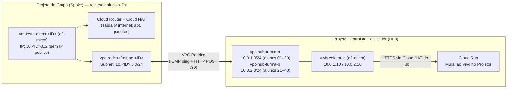

# Ementa Completa — Redes.tf: da Teoria à Prática com Terraform e GCP

  
  &nbsp;&nbsp;&nbsp;&nbsp;&nbsp;
  

<table>
  <tr>
    <td width="110" align="center">
      
    </td>
    <td>
      <strong>Evento:</strong> e-info 2026 — FACAPE (Faculdade de Ciências Aplicadas e Sociais de Petrolina) 
      <strong>Facilitador:</strong> Luan Sousa (<em>Cloud Engineer na SantoDigital | Google Cloud Digital Leader | Bacharelando em Ciência da Computação — FACAPE</em>) 
      <strong>Carga Horária Total:</strong> 8 horas (1 dia intensivo: Manhã <code>08h00–12h00</code> | Tarde <code>14h00–18h00</code>) 
      <strong>Modalidade:</strong> Presencial, 100% prática (<em>Live Coding</em> do zero ao fim no Google Cloud Platform com Terraform) 
      <strong>Público-alvo:</strong> Todos os níveis (estudantes e profissionais de TI)
    </td>
  </tr>
</table>

---

## 1. Proposta Pedagógica

Na graduação, conceitos como **endereçamento IPv4, cálculo de sub-rede (CIDR), tabelas de roteamento, NAT e firewalls** muitas vezes parecem abstratos ou restritos a simuladores estáticos. No mercado de Engenharia Cloud e DevOps, esses mesmos fundamentos são a espinha dorsal de qualquer arquitetura moderna — porém declarados como código (**Infraestrutura como Código — IaC**) sobre redes definidas por software (**SDN**).

Este minicurso faz a ponte direta entre a **Teoria Clássica de Redes de Computadores** e a **Engenharia de Nuvem Real**:
1. **Nenhum recurso é criado no "clique-a-clique" (ClickOps):** O Console do Google Cloud é utilizado apenas para **visualizar e inspecionar** o que nós construímos via código com o **Terraform**.
2. **Construção do Zero ao Fim (*Live Coding*):** Cada arquivo `.tf` é escrito em conjunto durante a aula dentro de `terraform/live-coding/`, entendendo o papel de cada atributo antes do `terraform apply`.
3. **Evolução Incremental:** Começamos com recursos explícitos para dominar a fundo cada peça de rede (Etapas 01 a 04) e encerramos refatorando a infraestrutura para **Módulos Reutilizáveis (`modules/`)** seguindo boas práticas reais de mercado (Etapa 05).

---

## 2. Matriz de Conexão: Teoria de Redes × Google Cloud × Terraform

| Conceito Clássico de Redes | Equivalente no Google Cloud (SDN) | Recurso no Terraform (`hashicorp/google`) | Etapa Prática |
| :--- | :--- | :--- | :---: |
| **Rede Local / Domínio de Roteamento Virtual** | **VPC Network** (Global, modo Custom) | `google_compute_network` | Etapa 01 |
| **Sub-rede IPv4, Máscara de Rede e Bloco CIDR** | **Subnet Regional** (`10.<ID>.0.0/24`) + IPs reservados do GCP (`.1` Gateway, `.254`, `.255`) | `google_compute_subnetwork` | Etapa 01 |
| **Firewall Stateful, ACLs, Portas TCP/UDP e ICMP** | **VPC Firewall Rules** distribuídas no hipervisor + *Network Tags* + **Cloud IAP** (`35.235.240.0/20`) | `google_compute_firewall` | Etapa 02 |
| **Host / Nó de Rede com Interface Virtual (vNIC)** | **Compute Engine VM (`e2-micro`)** sem IP público (isolada na sub-rede privada) | `google_compute_instance` | Etapa 02 |
| **Tabela de Roteamento, Next-Hop e Default Gateway** | **VPC Routes** (Rota local de sub-rede e Default Internet Gateway `0.0.0.0/0`) | `google_compute_route` (rota estática explícita + inspeção das rotas implícitas) | Etapa 03 |
| **SNAT (Source Network Address Translation) / PAT** | **Cloud Router + Cloud NAT** (Saída para internet sem expor IP público na VM) | `google_compute_router` + `google_compute_router_nat` | Etapa 03 |
| **Interconexão entre Sistemas Autônomos / Redes Privadas** | **VPC Network Peering** (Troca de rotas diretas entre Projetos distintos sem passar pela internet) | `google_compute_network_peering` | Etapa 04 |
| **Engenharia de Software Aplicada à Infraestrutura (DRY)** | **Padrões de Arquitetura Cloud Reutilizáveis** | Blocos `module "vpc"`, `module "firewall"`, `module "peering_hub"` + blocos `moved` | Etapa 05 |

---

## 3. Dinâmica do Laboratório e o "Desafio do Mural Central" (Hub-and-Spoke)

Para tornar a prática colaborativa e tangível, cada aluno constrói **a sua própria rede isolada** dentro do projeto GCP do seu grupo (até 4 alunos por projeto, `einfo-redes-grupo-XX`, isolados pelo sufixo `aluno-XX`) e, no Turno da Tarde, conecta essa rede ao **Projeto Central (Hub)** mantido pelo facilitador:

1. **Prevenção de Conflito de IP (*CIDR Overlap*):**
   - Cada aluno recebe antes do curso um número **`student_id`** (de `1` a `40`).
   - A sub-rede do aluno é calculada dinamicamente via Terraform como `10.${var.student_id}.0.0/24` (ex: Aluno `12` -> `10.12.0.0/24`), enquanto o Hub Central usa `10.0.1.0/24` e `10.0.2.0/24`.
   - Como o GCP limita **25 peerings por VPC**, o Hub é dividido em duas VPCs ("Turma A/B" são apenas *shards*; todos estão na mesma aula): alunos `01–20` → `vpc-hub-turma-a`; alunos `21–40` → `vpc-hub-turma-b`.
2. **Validação Visual no Projetor (Momento *Aha!*):**
   - Em cada VPC do Hub, uma instância leve **`e2-micro`** (`10.0.1.10` / `10.0.2.10`) responde a `ping` (ICMP) e recebe requisições HTTP privadas na porta `80`.
   - Assim que o aluno configura o **VPC Peering** (Etapa 04), ele acessa sua VM privada via **SSH com Cloud IAP** e executa um `curl` para `http://10.0.1.10/checkin` (ou `10.0.2.10`).
   - O coletor identifica o aluno pelo **IP privado real de origem** (`10.<ID>.0.x`) e atualiza em tempo real um **painel web no Cloud Run** exibido no projetor, acendendo o card do aluno!

---

## 4. Cronograma Detalhado — Turno da Manhã (08h00 às 12h00)

> **Foco da Manhã:** Fundamentos de Redes em Cloud, Introdução ao Terraform, Construção da VPC/Sub-redes e Segurança com Firewalls + VMs Privadas.

### Módulo 1 — Boas-vindas, Alinhamento do Foundation e Redes na Nuvem (`08h00 – 09h00` | 60 min)
- **08h00 – 08h20 | Abertura e Check-in do Pré-material:**
  - Apresentação do minicurso, objetivos das 8h e conferência da tabela de **`student_id`** (`01` a `40`) enviada no pré-material.
  - Validação rápida do ambiente dos alunos (quem está usando máquina local vs. **Google Cloud Shell**) e checagem do acesso ao projeto GCP do grupo (`einfo-redes-grupo-XX`).
- **08h20 – 09h00 | Da Teoria Clássica à SDN do Google Cloud:**
  - Revisão visual e prática: O que é um endereço IPv4, máscara de sub-rede (`/24`, `/16`, `/32`) e notação **CIDR**.
  - Como funciona uma rede física tradicional (switches, roteadores, cabos) vs. **Andromeda** (a rede definida por software global do Google Cloud).
  - Anatomia de uma **VPC no GCP**: Por que a VPC é **Global** e as Sub-redes (**Subnets**) são **Regionais**?
  - Os 4 endereços IP reservados em toda sub-rede do GCP (`.0` Rede, `.1` Default Gateway, `.254` Penúltimo reservado, `.255` Broadcast).

### Módulo 2 — Infraestrutura como Código com Terraform (`09h00 – 09h50` | 50 min)
- **09h00 – 09h25 | Por que automatizar redes com código?**
  - O problema do *ClickOps* (configurações manuais no painel, falta de histórico, erro humano em regras de firewall, impossibilidade de replicar ambientes).
  - Como o **Terraform** funciona: linguagem declarativa **HCL**, **Providers** (`hashicorp/google`), **Resources**, **Data Sources**, **Variables**, **Locals** e **Outputs**.
  - O coração do Terraform: O arquivo de estado (`terraform.tfstate`) e o ciclo de vida **`init` -> `fmt` -> `validate` -> `plan` -> `apply` -> `destroy`**.
- **09h25 – 09h50 | Live Coding Parte 0 — Estruturando a Base do Projeto (`terraform/live-coding/`):**
  - Criação ao vivo dos arquivos iniciais: `versions.tf`, `providers.tf` e `variables.tf` (incluindo `project_id`, `region` e `student_id` com regra de `validation`).
  - Execução do `terraform init` e inspeção do diretório `.terraform/`.

### Intervalo / Coffee Break da Manhã (`09h50 – 10h10` | 20 min)

### Módulo 3 — Live Coding Etapa 01: VPC Customizada e Sub-redes (`10h10 – 11h00` | 50 min)
- **10h10 – 10h25 | Conceito Aplicado — Modo Auto vs. Modo Custom:**
  - Por que nunca devemos usar a VPC `default` ou o modo `auto_create_subnetworks = true` em ambientes profissionais (sobreposição de CIDRs `10.128.0.0/9` e regras de firewall permissivas).
- **10h25 – 11h00 | Mão na Massa (`01-vpc-subnets`):**
  - Escrita ao vivo do `locals.tf` (interpolando o CIDR `10.${var.student_id}.0.0/24` e sufixos padronizados).
  - Escrita do `vpc.tf`: recurso `google_compute_network` (em modo custom) e `google_compute_subnetwork` (com `private_ip_google_access = true`).
  - Criação do `outputs.tf` para exibir o nome da VPC, o CIDR calculado e o IP do gateway interno.
  - Execução do `terraform plan` e `terraform apply` e inspeção visual no Console do GCP (menu *VPC networks*).

### Módulo 4 — Live Coding Etapa 02: Firewall Stateful, IAP e VM Privada (`11h00 – 12h00` | 60 min)
- **11h00 – 11h20 | Conceito Aplicado — Segurança Zero-Trust na Rede:**
  - Como funciona um **Firewall Stateful** (se a ida é permitida, o pacote de resposta volta automaticamente sem precisar de regra extra).
  - Direção do tráfego (**Ingress** vs. **Egress**), Prioridade (`0` a `65535`), Ação (`ALLOW` vs. `DENY`) e uso de **Network Tags** para aplicar regras apenas às VMs desejadas.
  - Como acessar uma VM **sem IP Público**? Explicação do **Cloud IAP (Identity-Aware Proxy)** TCP Forwarding e o range oficial da Google (`35.235.240.0/20` na porta `22`).
- **11h20 – 12h00 | Mão na Massa (`02-firewall-vms`):**
  - Escrita ao vivo do `firewall.tf`:
    1. Regra permitindo SSH (`tcp:22`) exclusivamente a partir do bloco do **Cloud IAP** (`35.235.240.0/20`) para VMs com a tag `ssh-iap`.
    2. Regra permitindo ICMP (`ping`) a partir da própria sub-rede do aluno — e a discussão de **por que não precisamos abrir nada para o Hub** (firewall *stateful*: respostas de conexões que nós iniciamos voltam sozinhas).
  - Escrita ao vivo do `compute.tf`:
    - Provisionamento de uma VM `e2-micro` Debian 12 conectada à sub-rede do aluno **sem bloco `access_config`** (ou seja, **100% privada, sem IP externo!**).
  - `terraform apply`, conexão na VM privada usando `gcloud compute ssh --tunnel-through-iap` e o **teste provocativo antes do almoço**:
    - Dentro da VM, o aluno tenta rodar `ping -c 3 8.8.8.8` ou `sudo apt update` e descobre que **o pacote não sai para a internet**! (*Gancho perfeito para o Turno da Tarde: Roteamento e Cloud NAT*).

---

## 5. Cronograma Detalhado — Turno da Tarde (14h00 às 18h00)

> **Foco da Tarde:** Tabelas de Roteamento, Saída Segura com Cloud NAT, Interconexão Hub-and-Spoke via VPC Peering e Boas Práticas de Engenharia Cloud com Módulos do Terraform.

### Módulo 5 — Live Coding Etapa 03: Roteamento, Cloud Router e Cloud NAT (`14h00 – 15h00` | 60 min)
- **14h00 – 14h20 | Conceito Aplicado — Por que nossa VM privada não acessou a internet?**
  - Análise da **Tabela de Roteamento (Routes)** da VPC: rota local da sub-rede (`10.<ID>.0.0/24`) e rota padrão (`0.0.0.0/0` -> *Default Internet Gateway*).
  - A diferença entre ter uma rota para a internet e ter um IP válido na internet: O papel do **NAT (Network Address Translation / SNAT)**.
  - Arquitetura do **Cloud NAT** no GCP: um NAT definido por software no plano de dados (sem máquina gargalo), gerenciado em conjunto com o plano de controle do **Cloud Router**.
- **14h20 – 15h00 | Mão na Massa (`03-roteamento-nat`):**
  - Escrita ao vivo do `routes.tf`: uma **rota estática explícita** `google_compute_route` (`0.0.0.0/0` -> `default-internet-gateway`, prioridade `900`, aplicada pela *network tag* `aluno-XX`) e inspeção da tabela com `gcloud compute routes list`. Teste: o `ping 8.8.8.8` **continua falhando** — rota não é NAT!
  - Escrita ao vivo do `nat.tf`: criação do `google_compute_router` e do `google_compute_router_nat` configurado para traduzir automaticamente todas as sub-redes da região (`ALL_SUBNETWORKS_ALL_IP_RANGES`).
  - Execução do `terraform apply`.
  - Retorno ao terminal SSH da VM privada: agora `ping -c 3 8.8.8.8`, `curl ifconfig.me` e `sudo apt update && sudo apt install -y curl iputils-ping` funcionam perfeitamente, enquanto a VM continua **100% invisível para ataques vindos da internet**!

### Módulo 6 — Live Coding Etapa 04: VPC Peering com o Projeto Central (`15h00 – 16h05` | 65 min)
- **15h00 – 15h20 | Conceito Aplicado — Conectando Redes Privadas Distintas:**
  - Como duas empresas, dois times ou uma arquitetura **Hub-and-Spoke** se comunicam no GCP sem passar pela internet pública?
  - Comparativo arquitetural rápido: **VPC Network Peering** vs. **Cloud VPN (IPsec + BGP)** vs. **Shared VPC** vs. **Private Service Connect (PSC)**.
  - Regras de ouro do **VPC Peering**:
    1. **Não pode haver sobreposição de CIDR (*No CIDR Overlap*)** — por isso cada aluno usou `10.<ID>.0.0/24` e o Hub usa `10.0.1.0/24` / `10.0.2.0/24`.
    2. **Acordo Bilateral:** o Peering só fica `ACTIVE` quando o Lado A aponta para o Lado B e o Lado B aponta para o Lado A.
    3. **Não-transitividade:** se o Aluno 01 tem peering com o Hub e o Aluno 02 tem peering com o Hub, o Aluno 01 **não** enxerga o Aluno 02 diretamente (isolamento entre alunos!).
- **15h20 – 16h05 | Mão na Massa e Desafio do Mural (`04-vpc-peering-hub`):**
  - Escrita ao vivo do `peering.tf`: recurso `google_compute_network_peering` conectando a `vpc-redes-tf-aluno-<ID>` à VPC do Projeto Central (`vpc-hub-turma-a` ou `vpc-hub-turma-b`, escolhida por expressão condicional a partir do `student_id`).
  - `terraform apply` dos alunos + sincronização no Hub Central pelo facilitador.
  - Inspeção no Console GCP: o status muda de `INACTIVE` para **`ACTIVE`** e a rota do Hub (`10.0.1.0/24` ou `10.0.2.0/24`) aparece automaticamente nas rotas efetivas de cada aluno!
  - **O Momento *Aha!* no Projetor:**
    - Da sua VM privada, cada aluno testa `ping -c 3 10.0.1.10` (ou `10.0.2.10`) e dispara o `curl` de check-in (output `comando_checkin_mural`) para a VM coletora do seu Hub, fazendo seu nome, `student_id` e IP privado aparecerem ao vivo no **Mural do Cloud Run** projetado no telão!

### Intervalo / Coffee Break da Tarde (`16h05 – 16h25` | 20 min)

### Módulo 7 — Live Coding Etapa 05: Boas Práticas com Módulos do Terraform (`16h25 – 17h30` | 65 min)
- **16h25 – 16h45 | Conceito Aplicado — De Scripts Soltos para Engenharia Cloud em Produção:**
  - Revisão crítica do código que construímos até aqui: E se precisarmos replicar exatamente essa mesma topologia para 3 ambientes (`dev`, `staging`, `prod`) ou 20 clientes na consultoria? Vamos copiar e colar todos os arquivos `.tf`?
  - O conceito de **Módulos no Terraform (`modules/`)**: encapsulamento, princípio DRY (*Don't Repeat Yourself*), contratos de entrada (`variables.tf`), processamento interno (`main.tf`) e contratos de saída (`outputs.tf`).
  - Como organizar repositórios de infraestrutura no mundo real (módulos locais vs. Registry público vs. repositórios Git versionados com tags `v1.0.0`).
- **16h45 – 17h30 | Demonstração Guiada e Arquitetura Pronta (`05-boas-praticas-modules` + `terraform/modules/`):**
  - Apresentação estruturada (com o código já pré-construído e fornecido aos alunos) dos 3 módulos reutilizáveis em `terraform/modules/`:
    1. `modules/vpc-network` (encapsula VPC + Sub-rede + Cloud Router + Cloud NAT).
    2. `modules/firewall-rules` (encapsula as regras de IAP e ICMP de forma parametrizada).
    3. `modules/vpc-peering` (encapsula o fechamento do Peering).
  - Análise comparativa lado a lado: os arquivos recursos brutos das Etapas 01–04 vs. o `05-boas-praticas-modules/main.tf` instanciando os blocos `module` com poucas linhas legíveis e padronizadas.
  - Demonstração do `terraform init` (inicialização em `.terraform/modules/`) e `terraform plan`.
  - **Refatoração sem downtime com blocos `moved`:** copiando o state do live-coding para a Etapa 05, o `terraform plan` mostra apenas *"has moved to"* e `0 to add, 0 to change, 0 to destroy` — a rede viva passa a ser gerenciada por módulos sem recriar nada.
  - Reaproveitamento para `dev`/`staging`/`prod` com `envs/*.tfvars` e workspaces.

### Módulo 8 — Limpeza de Recursos (FinOps), Revisão e Encerramento (`17h30 – 18h00` | 30 min)
- **17h30 – 17h45 | Boas Práticas de FinOps e Ciclo de Vida (`terraform destroy`):**
  - Como o Terraform rastreia o grafo de dependências reverso para destruir primeiro a VM, o Peering, o NAT, a Rota, o Firewall, a Sub-rede e por último a VPC sem deixar recursos órfãos gerando custo.
  - Execução acompanhada do `terraform destroy` nos projetos dos alunos (na pasta que detém o state: `live-coding/`, ou `labs/05-.../` se o state foi migrado na demonstração).
- **17h45 – 18h00 | Retrospectiva da Arquitetura, Carreira em Cloud e Q&A:**
  - Revisão visual de tudo o que foi construído em 8 horas (do primeiro bloco CIDR até uma rede corporativa *Hub-and-Spoke* modularizada em código).
  - Dicas práticas de estudos, certificações Google Cloud / HashiCorp Terraform Associate e abertura para perguntas finais.

---

## 6. Critérios de Conclusão e Entregáveis do Aluno

Ao final das 8 horas do minicurso, cada participante terá:
1. Construído e versionado em Git uma infraestrutura de rede completa no Google Cloud usando Terraform (`>= 1.5`).
2. Configurado sub-redes privadas, regras de Firewall Stateful com Cloud IAP e saída segura à internet via Cloud NAT.
3. Estabelecido conectividade privada entre projetos distintos via **VPC Network Peering** e registrado presença no Mural Central do curso.
4. Estruturado e consumido **Módulos Reutilizáveis do Terraform** seguindo padrões profissionais de Engenharia Cloud.
